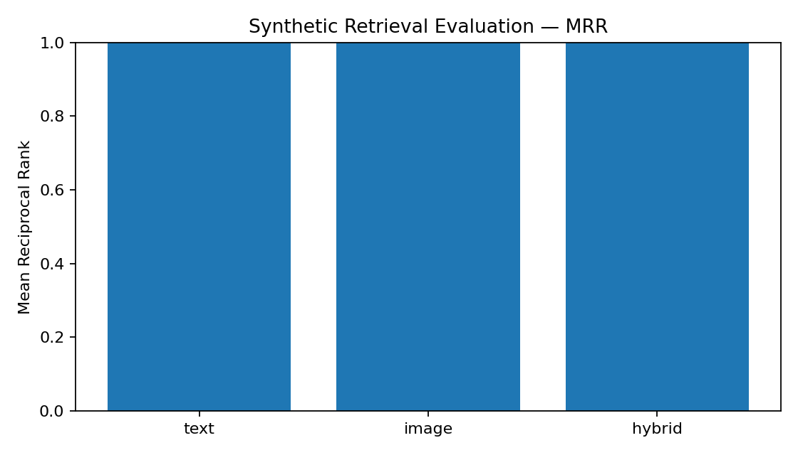

# Final implementation verification addendum — 14 November 2026

This addendum supersedes earlier implementation-status and deployment claims in the historical report below. The system remains an independent academic project without official university endorsement.

The final audit added a bilingual Smart Search and database-assistant screen backed by the existing APIs, report edit/close controls, admin-only evidence download with audit logging, same-origin browser API routing, per-owner idempotency keys, saved-report photo retries, and retrieval/matching safeguards. Visitor privacy and administrator-controlled ownership decisions are retained. Full translation of legacy screens, real Gemini image inference, pretrained E5/OpenCLIP deployment, dedicated PostgreSQL concurrency verification and production release remain open.

Executed local evidence: 41 pytest tests pass; lint, TypeScript and Next.js production build pass; six Playwright workflows pass against isolated SQLite and temporary uploads. The browser tests exercise anonymous use, language switching, upload retry, real database search and fallback assistant, lost/found reports, private claims, additional evidence requests, admin evidence download and recovery notifications. These are not tests of every browser, every failure mode or production PostgreSQL. See `docs/verification/final-results.md` for commands and limitations.

Two live production Gemini calls returned google_gemini for Chinese text attribute extraction and Chinese-to-English description improvement. No synthetic image/report was uploaded to production; image inference remains unverified. E5-small and OpenCLIP remain optional and disabled in production. Tested methods are the bilingual rule/hash fallback and HSV image histogram, not pretrained inference.

A separate deterministic experiment uses four bilingual queries and eight candidate reports including same-category attribute hard negatives. All four positives rank first (MRR 1.0); 4 of 28 nonpositive pairs exceed the 35-point notification threshold (14.29%). This small synthetic dataset does not establish real-world accuracy. Measured pair-comparison median latency is 1.182 ms and p95 2.186 ms locally, excluding provider/network time and image inference. Scores express retrieval similarity, never ownership probabilities. Human review remains essential.

The inspected existing API deployment identifies commit 685112e4b4527691abf507a673450213de1119a3; the audit branch is not deployed. GitHub Actions run 43540537239 passed all three jobs, including migrations and 41 tests on PostgreSQL 17/pgvector and six isolated browser tests. Upload persistence, coordinated backups and restore must be verified before release. Existing DOCX/PDF outputs should be considered historical unless regenerated from this Markdown and checked.

---

# BEIHANG UNIVERSITY
## 2026-2027 Academic Year, First Semester

# 《Artificial Intelligence Practice》
## Final Project Experiment Report

# Beihang SmartFind
### 北航校园智能失物招领系统
### An AI-Powered Multimodal Campus Lost-and-Found Platform

**Student Name:** ________________________
**Student ID:** ________________________
**Class:** ____________________  
**Grade:** ____________________  
**Report Date:** November 2026  

Final audit: 41 isolated backend/migration tests and six local Playwright workflows pass. Lint, TypeScript and production build pass. Live Gemini text analysis and Chinese-to-English improvement returned google_gemini. Real image inference and pretrained E5/OpenCLIP remain unverified. Dedicated PostgreSQL concurrency/load testing, production deployment of this branch, legacy-cookie transition and backup restore remain release gates. See docs/verification/final-results.md.

---

# 1. Creative Background

## 1.1 The practical problem

Students move between lecture rooms, libraries, laboratories, dining facilities, sports areas and residence buildings throughout the day. Personal belongings can be misplaced during these transitions. Common examples include wireless earbuds, mobile phones, wallets, keys, student identification cards, backpacks, books, watches and reusable water bottles. Losing an object creates more than a small inconvenience. A student may lose time retracing their route, ask several classmates, search a messaging group, or visit a physical service desk. A person who finds an object may have no reliable way to identify its owner without exposing private information or handing the object to an unknown person.

A university campus is also a multilingual environment. Students may describe the same object in English, Simplified Chinese or a mixture of both. A student may write “black wireless earbuds case”, while another writes “黑色蓝牙耳机盒”. A simple keyword search may fail because the two descriptions do not share the same written words. The descriptions may also differ in detail: one person remembers the colour and location, while another remembers the shape, a scratch or a sticker. The challenge is therefore not only to store reports. It is to retrieve potentially related reports from incomplete, differently worded and multilingual information.

## 1.2 The proposed solution

Beihang SmartFind is an independent campus lost-and-found platform designed around this practical problem. It provides one place for students to report a lost object, report an object they have found, browse reports, search descriptions, inspect potential matches and submit an ownership claim. An administrator can review reports and claims, request more evidence, approve or reject a claim, and mark a verified item as recovered. The system is designed for a university context, but it does not claim official access to Beihang University services, identity systems, campus security systems or real student records. Campus areas are configurable labels, and the included records are synthetic examples created for demonstration.

The main technical contribution is a multimodal matching pipeline. It attempts to combine text similarity, image similarity, category, colour, time and campus-zone proximity. Text processing is intended to support English-to-Chinese and Chinese-to-English retrieval. Image processing is intended to compare visual representations rather than filenames. Gemini is used as a generative assistant for extracting visible attributes, improving descriptions and explaining candidate matches. The matching score is calculated by a deterministic service rather than delegated to a generative model. This separation makes the score reproducible and allows the explanation to be checked against explicit evidence.

## 1.3 Project objectives

The project has six practical objectives. First, it centralizes lost and found reports so that students do not have to rely on scattered social posts. Second, it accepts photographs and descriptions, allowing reports to contain more than a title. Third, it supports English and Simplified Chinese interface text and prepares multilingual semantic retrieval. Fourth, it ranks possible LOST-to-FOUND pairs using the signals that are actually available. Fifth, it protects private ownership details and requires human verification before an item is marked recovered. Sixth, it provides an experimental framework for comparing text-only, image-only and hybrid retrieval on a known synthetic dataset.

The project also has an educational objective. It connects artificial intelligence concepts with a recognizable student-life problem. It demonstrates how a large language model, computer vision, text embeddings, vector search, a relational database, a web application and an evaluation script can be combined into a coherent application. The aim is not to claim that an AI system can prove ownership. Its purpose is to reduce the number of reports a student must inspect manually while keeping the final recovery decision under human control.

# 2. Selected Large Model

## 2.1 Google Gemini as the primary generative model

Google Gemini is the primary generative provider, using the official server-side Google Gen AI SDK. GEMINI_API_KEY remains backend-only and GEMINI_MODEL selects the model. The inspected production model is gemini-3-flash-preview. Two live text calls succeeded in this audit; image understanding uses the SDK image Part path but remains unverified with real inference.

## 2.2 Intended Gemini tasks

The first task is image and description analysis. Given a photograph and a student-provided description, the service is designed to return structured fields such as item category, item type, visible colour, visible attributes, a concise description, language, confidence and uncertainty. The prompt explicitly asks the model not to infer hidden ownership information, serial numbers or details that cannot be observed. The response is validated against a Pydantic schema before being stored. The second task is description assistance. Gemini can suggest a clearer title and description, but the student must review and approve the suggestion before using it. The third task is match explanation. The matching engine supplies the actual component scores and missing signals; Gemini is asked to explain only that evidence and is told not to call a similarity score a probability of ownership.

## 2.3 Failure handling and honest reporting

Gemini is optional for application startup. When the key or SDK is unavailable, the backend returns a clearly labelled rule-based fallback. When a live request fails, the provider field becomes `rule_fallback_after_gemini_error`; it is not reported as a successful Gemini response. The service status endpoint distinguishes whether a key is configured, whether the SDK is available and whether the live service can be attempted. This design allows students to create reports, browse listings and use non-generative matching even when an external AI service is unavailable. The official Gemini SDK is installed in the normal deployment image. No API key was provided, so the live Gemini path remains implemented but unverified.

## 2.4 Supporting representation models

Gemini is not used to calculate the final match score. Two separate representation models are prepared for retrieval. The text path is designed for `intfloat/multilingual-e5-small`, using the model’s query and passage prefixes. The image path is designed for OpenCLIP ViT-B/32, which produces a 512-dimensional visual representation. Both models are loaded lazily and cached within the process. Device selection can use CUDA, Apple Silicon MPS or CPU. The current environment did not contain the pretrained E5 or OpenCLIP packages and weights. The implemented fallbacks are therefore explicitly labelled: `bilingual_rule_hash_fallback` for text and `opencv_hsv_histogram_fallback` for images. These fallback methods are useful for local demonstrations and software tests, but they are not equivalent to pretrained multilingual E5 or CLIP inference.

# 3. Overall Design Plan

## 3.1 Full-stack architecture

SmartFind is organized as a monorepo with a Next.js frontend and a FastAPI backend. The frontend uses React, TypeScript, Tailwind CSS and Lucide icons. It contains routes for the landing page, login, registration, student dashboard, lost listings, found listings, lost/found reporting forms, item details, matches, claims, notifications, profile, settings and administrator pages. The interface includes a language selector for English and Simplified Chinese. Translation currently covers shared navigation, the landing page, authentication, reporting forms and key workflow labels; secondary administrator and supporting copy still require a complete translation review. The language preference is stored in browser local storage, so changing the interface language does not require a page navigation or discard the form state.

The backend uses Python, FastAPI, Pydantic and SQLAlchemy 2. Application endpoints are versioned under `/api/v1/`. Database access is separated from route handlers through a session dependency and model/service modules. Alembic is configured for migrations. The local quick-start path uses SQLite so that the API and workflow tests do not require a database server. The Docker Compose configuration uses PostgreSQL 16 with the pgvector extension and persistent volumes. Text vectors are configured for 384 dimensions and image vectors for 512 dimensions. HNSW cosine indexes are included for vector retrieval in PostgreSQL deployments.

## 3.2 Database design

The current relational model contains twelve tables. The `users` table stores accounts, role and language preference. `campus_zones` stores configurable campus-area labels and adjacency relationships. `listings` stores LOST and FOUND reports, owner, category, colour, time, state and private identifiers. `listing_images` stores image metadata and storage locations. `listing_ai_analysis` stores the provider and structured attributes returned by analysis. `text_embeddings` and `image_embeddings` store vectors together with the method used to generate them. `matches` stores candidate pairs, score components, method metadata and explanation. `claims` stores private verification details, evidence location, review status and administrator notes. `notifications` stores in-app updates with unique deduplication keys. `audit_logs` records important administrative actions. `match_feedback` records whether a user considered a candidate relevant.

This separation is important for reproducibility and privacy. The public listing serializer deliberately omits private identifying details. A student can view the status of their claim but cannot retrieve their private verification answer from the ordinary claim endpoint. An administrator can inspect the submitted verification details and the private identifying details associated with the found report. Claim evidence is stored under a private directory and is not mounted as public static media. Synthetic records are marked with an `is_synthetic` field so that demonstration data is not confused with actual campus reports.

## 3.3 Multimodal matching mathematics

The initial matching weights are text 0.32, image 0.28, category 0.12, colour 0.08, time 0.10 and location 0.10. Each available signal is normalized to a range from zero to one. If `A` is the set of signals that can be compared, `w_i` is the configured weight and `s_i` is the signal score, the final score is:

`Final Score = 100 × Σ(w_i × s_i) / Σ(w_i), for i in A`.

The denominator is the sum of weights for available signals only. If a listing has no photograph, image similarity is missing rather than perfect or zero. If a date is absent, time similarity is omitted. The remaining signals are reweighted proportionally. This prevents incomplete reports from receiving an artificial advantage or penalty. Category and colour use normalized comparisons. Time uses an exponential decay based on the distance between report times. Location uses a configurable campus-zone adjacency map: the same zone receives a stronger relationship than an adjacent zone, while a non-adjacent zone receives a lower score. The system does not invent campus coordinates.

The matching service enforces opposite report types. A LOST report is compared with FOUND reports, and a FOUND report is compared with LOST reports. It excludes closed reports, stores the best candidates and returns at most five. The score is a ranking measure and not a probability of ownership. A high score cannot automatically approve a claim or change an item to recovered.

## 3.4 Storage and security design

Image upload handling checks the filename extension and decodes the actual image content with Pillow. The upload size is limited by configuration. The backend creates a random filename rather than trusting the browser filename. The image is re-encoded, which removes EXIF metadata, and public listing photos are stored separately from private claim evidence. The public media route exposes only the public directory. Passwords are hashed with PBKDF2-HMAC-SHA256 using a random salt. Access tokens are HMAC-SHA256 signed and expire according to configuration. Role checks protect administrator routes, and owner checks protect listing updates and matching operations. A production startup guard rejects the default development JWT secret and administrator password. A basic in-process rate limiter is applied to authentication and API traffic; a multi-worker production deployment should replace it with a shared rate limiter.

## 3.5 Main workflow

A student registers and logs in. The student creates a LOST or FOUND listing, adds the item title, category, colour, description, campus zone and approximate time, and may upload a photograph. The backend stores the report, creates a text representation and processes the image if supplied. Gemini analysis is attempted only when configured. The matching service compares the new report with opposite-status records and saves potential candidates. Notifications are created with unique keys so the same match does not repeatedly notify the same user. A student who believes a found report is theirs submits private identifying details. An administrator reviews the claim, can request additional evidence, and can approve or reject it. Approval changes the found listing and any linked lost listing to RECOVERED and notifies the claimant. This lifecycle intentionally keeps the final decision human-controlled.

# 4. Experimental Steps

## 4.1 Environment preparation

The execution environment provided Python 3.13.5, Node.js 22.16.0, npm 10.9.2, Git, FastAPI, SQLAlchemy, Alembic, Pydantic, pytest, HTTPX, Pillow, OpenCV, NumPy, python-docx, ReportLab, Matplotlib and Chromium. Docker was not installed. The environment could not resolve the npm registry, so Next.js dependencies could not be downloaded. The core backend dependencies already present were sufficient to compile and execute the FastAPI application and run its SQLite-based tests. Optional AI packages and model weights were not present.

The project configuration is provided in `.env.example`. A developer copies it to `.env`, supplies a strong JWT secret and administrator password, and adds a Gemini key if live generation is required. `requirements.txt` contains the core backend dependencies. `requirements-ai.txt` contains the optional Gemini SDK, sentence-transformers, OpenCLIP and PyTorch packages. This split keeps a basic local demonstration from requiring the large model packages before the user chooses to install them.

## 4.2 Database and synthetic data setup

The seed script creates five configurable demonstration zones: Main Library, Engineering Building, Student Cafeteria, Sports Hall and Residence Zone A. It creates student and administrator demo accounts and synthetic LOST and FOUND records in English and Chinese. It also generates simple local demonstration illustrations for earbuds, a wallet, a backpack, keys and a water bottle. These generated illustrations are synthetic assets and do not represent photographs of real students’ property. The seed script stores image metadata and the corresponding fallback image vectors. The data is repeatable and labelled as synthetic.

## 4.3 API and workflow testing

The backend suite now passes 41 tests, including anonymous session isolation/revocation/CSRF, report ownership, validated uploads, private evidence access, claim review, retrieval fallback, same-owner match exclusion, idempotent retries, and fresh/existing-schema migration. SQLite results do not establish PostgreSQL concurrency correctness.

A live Uvicorn process was also started against the seeded local SQLite database. The health and readiness endpoints returned HTTP 200, and readiness identified SQLite as the active database. A separate live synthetic end-to-end workflow registered two student accounts, created one LOST and one FOUND report, uploaded a PNG photograph, generated five potential candidates, submitted a claim linked to the candidate match, and approved the claim through an administrator account. The selected candidate score in that run was 63.34 (a ranking score, not a probability). The live upload reported `opencv_hsv_histogram_fallback` for the image and `rule_fallback` for Gemini, correctly identifying that pretrained OpenCLIP and live Gemini were not used. After approval, both linked reports were `RECOVERED` and the claimant received a `CLAIM_APPROVED` notification. This is a software smoke test against synthetic records, not a real campus experiment.

## 4.4 Evaluation procedure

The evaluation script loads the synthetic LOST and FOUND reports and the known positive pairs. It creates rankings using the text component alone, the image component alone and the hybrid score. It calculates Precision@5, Recall@5 and Mean Reciprocal Rank, and records the method names used for text and image representations. It also checks the rank of three known English-to-Chinese pairs. The script writes JSON and CSV files and generates an MRR chart. The actual output is stored in `docs/evaluation/` so that the reported numbers can be reproduced rather than typed manually into the report.

# 5. Program Running Effect

## 5.1 Verified backend behaviour

The backend starts successfully with the local SQLite configuration. Its OpenAPI document is available through FastAPI’s interactive documentation. The tested authentication flow issues a signed token and protects routes that require a student or administrator identity. Listing creation stores the report and text embedding. When a new report is created, the backend attempts to compare it with opposite-status reports. The image upload test confirms that a valid image can be accepted, re-encoded and assigned an image representation. In the current environment, the method returned by that image path is the HSV histogram fallback, not OpenCLIP.

The matching tests confirm that the service pairs a LOST report with a FOUND report and rejects the assumption that two LOST reports form a recovery match. The response exposes the available component signals, the methods used and a statement that the score is not a probability. Duplicate detection returns a warning and an explicit `automatic_action` value of `none`. This means the system does not delete a report simply because its description or image appears similar to another report.

The claim tests confirm that a student can submit a claim for a found item and that an administrator can approve it. When the claim is linked to a LOST report through a potential match, both the found report and linked lost report change to `RECOVERED`. A student’s claim response does not return the private verification details, while the administrator review route can access the private data needed for manual comparison. The tests also verify that a normal student receives a forbidden response when requesting an administrator dashboard.

## 5.2 Actual synthetic evaluation results

The seeded evaluation set contains four LOST reports and five FOUND reports, with three known positive pairs. The methods observed in the current run were `bilingual_rule_hash_fallback` for text and `opencv_hsv_histogram_fallback` for image. The current script produced the following values:

| Retrieval mode | Precision@5 | Recall@5 | MRR |
|---|---:|---:|---:|
| Text-only | 0.20 | 1.00 | 1.00 |
| Image-only | 0.20 | 1.00 | 1.00 |
| Hybrid | 0.20 | 1.00 | 1.00 |

*Figure 1. MRR comparison generated by the evaluation script from the synthetic seed dataset.*

All three known cross-language examples ranked their corresponding Chinese FOUND report at rank one in the fallback test. These results are not evidence that multilingual E5 or CLIP has been tested. The small dataset has only five found candidates, so every candidate is included in a top-five list. Consequently, Recall@5 is guaranteed to be high when the one relevant record is present, and Precision@5 is low because the top-five list contains one relevant record among five candidates. The repeated synthetic image illustrations also make the image-only result easier than a realistic retrieval problem. The results demonstrate that the evaluation pipeline runs and that the configured bilingual fallback recognizes the selected demonstration terms. They do not establish real-world retrieval accuracy.

## 5.3 Deployed verification evidence

The frontend was built with patched Next.js 16.4.6, React and TypeScript, then deployed to the existing beihang-smartfind Vercel project. ESLint, TypeScript checking and production compilation all completed successfully. The backend runs independently on Railway in a dedicated SmartFind project. Its PostgreSQL 17 service contains pgvector and persistent storage; the application uses an independent volume for uploaded images and private evidence. The readiness endpoint returns HTTP 200 with database `postgresql`; database failures return HTTP 503.

The current local browser suite passes six workflows against temporary data and uploads, covering anonymous use, language persistence, mobile width, reporting and real image uploads, failed photo retry, database search, assistant fallback, claims, additional evidence, administrator download and recovery notifications. New screenshots use the final- prefix in docs/screenshots. Remote PostgreSQL CI passed 41 tests and migrations in run 43540537239; this does not establish race/load correctness.

Live Gemini text inference was verified; image inference remains open. E5 and OpenCLIP are optional and disabled in the inspected deployment. Tested methods use bilingual rule/hash vectors and HSV histograms. These are explicit fallbacks, not pretrained model results.

# 6. Experimental Summary

The implementation demonstrates a working backend foundation for an AI-assisted lost-and-found workflow. It combines account management, listings, private ownership claims, administrator review, notification persistence, hybrid ranking, duplicate warnings and a reproducible synthetic evaluation script. The code is modular: routes validate and authorize requests, services perform AI and matching work, and SQLAlchemy models represent stored records. The system keeps the generative model separate from the deterministic ranking calculation. This separation is important because a language model can produce a plausible explanation, but it should not invent a score or make an ownership decision.

The most important design characteristic is the handling of missing evidence. Reports are often incomplete, so a matching engine should not assume that an absent photograph or date is a negative signal. SmartFind excludes unavailable signals and normalizes the weights of the signals that remain. The second important characteristic is privacy. Private identifying details and claim evidence are not exposed in ordinary listing responses. The third characteristic is transparent fallback behaviour. When pretrained model dependencies are unavailable, the API reports the fallback method instead of presenting a simple histogram or keyword rule as a CLIP or E5 result.

The main limitations are small synthetic evaluation sets, unverified image-provider inference, disabled pretrained embeddings, incomplete legacy translations and pending production rollout/backup verification. Larger independently labelled datasets, PostgreSQL race/load testing and physical phone checks remain necessary.

# 7. Course Learning Summary

This project connects several topics from Artificial Intelligence Practice with a practical student-life application. The computer-vision component demonstrates that an image can be transformed into a numerical representation and compared with another representation. OpenCLIP is selected for this purpose because it can place image and text information into a shared representation space. The current fallback histogram also illustrates a simpler visual feature representation, while making clear that colour-distribution similarity is not the same as semantic object recognition.

The natural-language-processing component demonstrates text normalization, multilingual descriptions, query and passage embeddings, cosine similarity and retrieval ranking. The English-to-Chinese examples show why exact keyword matching is insufficient. The E5 integration is designed to compare meaning across languages when the pretrained model is available. The fallback dictionary demonstrates a limited alternative for known vocabulary and also shows why a real multilingual model is needed for broad language coverage.

The large-model component demonstrates how Gemini can turn unstructured descriptions and photographs into structured attributes. Pydantic validation provides a boundary between model output and application data. The system also illustrates the importance of prompt constraints: the model should describe visible details, preserve uncertainty and avoid inventing private ownership facts. Generative output is treated as assistance rather than authority.

The database and algorithm components connect relational modeling with vector retrieval. PostgreSQL stores the report, user, claim and notification relationships, while pgvector is prepared for cosine-distance search over text and image vectors. The matching formula provides a transparent way to combine signals with different importance. The missing-data normalization rule demonstrates that algorithm design must reflect the quality and availability of input information. Evaluation metrics such as Precision@5, Recall@5 and MRR make the retrieval behaviour measurable, although the experiment also shows that metrics must be interpreted in light of dataset size and composition.

Finally, the project reinforces software engineering concepts: API versioning, authentication, role-based authorization, migrations, automated tests, Docker configuration, environment variables, file validation, logging and documentation. The most important lesson is that an AI feature should be integrated into a reliable system. A useful application needs data validation, error handling, privacy protection, measurable behaviour and a human decision process, not only a model call.

# 8. Main Reference Materials

1. Google AI for Developers, Gemini API documentation: https://ai.google.dev/gemini-api/docs
2. Google Gen AI Python SDK: https://github.com/googleapis/python-genai
3. OpenCLIP project and model documentation: https://github.com/mlfoundations/open_clip
4. Multilingual E5 model card: https://huggingface.co/intfloat/multilingual-e5-small
5. pgvector documentation: https://github.com/pgvector/pgvector
6. FastAPI documentation: https://fastapi.tiangolo.com/
7. SQLAlchemy 2.0 documentation: https://docs.sqlalchemy.org/en/20/
8. Alembic documentation: https://alembic.sqlalchemy.org/
9. Beihang University, *Experiment Report for the Major Project of Artificial Intelligence Practice*, 2026–2027 Academic Year First Semester, provided course template.

# 9. Core Code Explanation

## 9.1 Authentication and authorization

`backend/app/security.py` implements password hashing and token signing. Passwords are salted and processed with PBKDF2-HMAC-SHA256. The access token contains a user identifier, role and expiry time and is signed with a secret from the environment. `dependencies.py` verifies the bearer token, loads the active user and applies the administrator role check. This avoids trusting a role value supplied by the browser.

## 9.2 Embedding services

`backend/app/services/embeddings.py` loads multilingual E5 lazily and uses the required query/passage prefixes. If the model is unavailable, the service canonicalizes a limited bilingual vocabulary and produces a deterministic hash vector. The returned method name records which path ran. `vision.py` similarly attempts to load OpenCLIP ViT-B/32 and caches the model and preprocessing transform. If it cannot, it calculates a normalized HSV histogram. The method name makes the distinction explicit. Both services expose cosine similarity through a common helper.

## 9.3 Hybrid matching service

`backend/app/services/matching.py` contains the configurable signal weights, signal extraction and weighted normalization. It verifies that a candidate contains one LOST and one FOUND listing. It retrieves text and image representations, compares category and colour, calculates time decay and checks configured campus-zone adjacency. It records the available component values and missing signals. The final score is calculated from only the available signals. The service persists the match and creates deduplicated notifications for the two report owners. Gemini may produce a short explanation, but the numeric score remains deterministic.

## 9.4 API and workflow modules

The route modules separate authentication, listings, AI, matches, claims, notifications and administration. The listing service stores a text representation and triggers matching when a new report is created. The image upload endpoint validates and re-encodes the file, generates an image representation and stores analysis metadata. The claim service prevents a student from claiming their own found report and blocks duplicate active claims. The administrator route changes claim status and listing state, and records an audit event. The public serializer omits private identifiers.

## 9.5 Evaluation and reproducibility

`scripts/seed_demo.py` creates the synthetic records and generated object illustrations. `scripts/evaluate.py` ranks found reports for each lost report using text-only, image-only and hybrid signals. It calculates metrics from known positive pairs and saves the detailed rankings, cross-language outcomes, JSON summary and chart. `scripts/count_source_lines.py` counts meaningful first-party source lines while excluding dependencies, caches and generated build output. These scripts make the demonstration repeatable and reduce the risk of manually fabricating reported results.

## 9.6 Final implementation status

Final audit: 41 isolated backend/migration tests and six local Playwright workflows pass. Lint, TypeScript and production build pass. Live Gemini text analysis and Chinese-to-English improvement returned google_gemini. Real image inference and pretrained E5/OpenCLIP remain unverified. Dedicated PostgreSQL concurrency/load testing, production deployment of this branch, legacy-cookie transition and backup restore remain release gates. See docs/verification/final-results.md.

### Operational boundaries

Production rejects SQLite, weak default JWT secrets and wildcard/non-HTTPS CORS origins. Logout stores a token hash in the database and denies subsequent reuse. JWTs have unique identifiers so a fresh login does not reproduce a revoked token. Public listing serializers omit private identifying details and real student names. The administrator account is created only from an explicitly configured private password; the public local-demo seed refuses to run in production. Claim approval locks rows, protects finalized reports and sends a notification to the finder as well as the claimant. These controls have meaningful automated coverage, but do not establish a formal security audit.

The deployment is an academic demonstration. It does not implement university SSO, email ownership verification, password-reset delivery or institutional identity validation. Authentication tokens are stored in browser local storage; a hardened institutional deployment should consider an HttpOnly cookie session architecture and additional XSS defenses. The in-process rate limiter and synchronous model calls are appropriate to the current scale, but a larger deployment should use shared limits, background workers and measured capacity planning. Campus zone adjacency is configured by administrators and is not a measured geographic distance service.

### Reproducing the demonstration

Use two fictional student accounts. Submit a lost black backpack report near University Library, then a found black school bag report with matching category and location. Review the candidate explanation and fallback label. Submit an ownership claim containing a fictional private detail. Sign in as the privately provisioned administrator and review the claim before approving it. Verify that both linked reports show RECOVERED and that each student receives the appropriate notification. The exact guide, safe administrator-access instructions and model configuration are documented in `docs/demonstration.md`.
